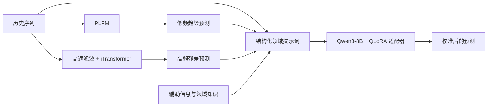

# LoFT-LLM

论文 **LoFT-LLM: Low-Frequency Time-Series Forecasting with Large Language Models** 的开源代码。
[论文](https://arxiv.org/abs/2512.20002v3) · [English](README.md) · [方法概览](#方法概览) · [快速开始](#安装) · [引用](#引用)

LoFT-LLM 面向训练数据有限的金融与能源时间序列预测，将低频趋势预测、高频残差学习与大模型校准结合起来，利用辅助信息和领域知识修正数值预测。

## 研究动机

历史数据有限时，高频噪声容易掩盖稳定的时间变化规律。同时，用户行为、气象条件等辅助变量包含有价值的领域信息，仅将其表示为数值特征可能难以充分利用这些信息。LoFT-LLM 通过频率感知学习与结构化自然语言提示词，将时序规律和领域语义结合起来。

## 方法概览

训练分为三个阶段：

| 阶段 | 模块 | 核心思路 |
| --- | --- | --- |
| 1. 低频学习 | 分块低频预测模块 PLFM | 对重叠的历史序列片段进行 FFT，以独立 MLP 建模频谱实部与虚部，并使用低通目标和频率对齐损失 FALoss 进行监督。 |
| 2. 残差学习 | iTransformer | 固定 PLFM，基于高通滤波后的历史序列学习残差，将趋势与残差预测相加，并使用 FALoss 训练。 |
| 3. 语义校准 | Qwen3-8B + QLoRA | 将历史序列、数值预测和辅助信息组织为领域提示词，通过监督微调，使大模型输出校准后的数值预测。 |

推理时，训练好的模块按以下流程协同工作：



## 实验任务概览

| 数据集 | 应用领域 | 采样频率 | 预测目标 |
| --- | --- | --- | --- |
| FundAR | 金融 | 每日 | 基金申购与赎回流量 |
| Solar | 能源 | 每小时 | 太阳能发电功率 |

[论文](https://arxiv.org/html/2512.20002v3) 在完整训练数据和少样本条件下进行预测对比，并通过消融实验和低频学习分析评估各模块。下文提供两个领域的配置与运行方法。

## 安装

建议使用 Python 3.10 和 CUDA 环境，按本机 CUDA 配置安装合适的 PyTorch，再安装依赖：

```bash
pip install -r requirements.txt
```

## 数据与配置

金融和 Solar 的配置分别为 `configs/fundar.json`、`configs/solar.json`；在其中设置数据目录、`cuda_visible_devices`、预测长度及模型路径。基础模型可以是 [Qwen/Qwen3-8B](https://huggingface.co/Qwen/Qwen3-8B) 或本地模型目录。数据和训练后的适配器需要另行获取或生成。

`common.root_path` 指定数据目录，`stages.<阶段>.data_path` 指定对应 CSV 文件名。数据加载器要求以下格式：

| 数据集 | 文件 | 列格式 |
| --- | --- | --- |
| FundAR | `ProductAmt.csv` | `date` 后接 88 个数值目标列 |
| FundAR | `ProductAmt_with_info.csv` | `date` 后先放相同顺序的 88 个目标列，再放辅助信息 |
| Solar | `Solar.csv` | `date` 后接一个功率目标列 |
| Solar | `Solar_Info.csv` | `date` 后先放功率目标，再放气象特征；总计至少 13 个数值列 |

FundAR 使用 44 个基金，以 `apply_amt_<基金ID>`、`redeem_amt_<基金ID>` 为目标列。辅助字段包含 `yield_`、`uv_fundown`、`uv_stableown`、`uv_fundopt`、`uv_fundmarket`、`is_trade` 和 `is_month_end` 等，列名与顺序须匹配 `layers/FinancialLLMProcess_utils.py`。数据来源为[天池基金流量预测比赛](https://tianchi.aliyun.com/competition/entrance/532224/information)。

Solar 特征由 `layers/SolarLLMProcess_utils.py` 按位置读取。以目标为数值列位置 0，使用的位置包括：1=`tclw`、2=`tciw`、4=`r`、5=`TCC`、6=`u10`、7=`v10`、9=`SSRD`、12=`TP`。须匹配该函数要求的完整列序，以及 prompt 中的时区、量纲与归一化方式。

监督样本仅从训练区间生成。推理时应提供预测时可获得的辅助信息。

## 训练与推理

在本目录依次执行各阶段。将 `fundar` 换成 `solar` 即使用 Solar 配置。

```bash
# 1. PLFM 低频学习
python run_release.py --config configs/fundar.json --stage plfm

# 2. 固定 PLFM，训练 iTransformer 残差学习器
python run_release.py --config configs/fundar.json --stage residual

# 3. 导出监督样本，随后 QLoRA 微调 Qwen3-8B
python run_release.py --config configs/fundar.json --stage sft
python run_release.py --config configs/fundar.json --stage qlora

# 加载微调适配器，运行 LLM 校准与评估
python run_release.py --config configs/fundar.json --stage infer
```

每条命令支持 `--horizon 3`，同一流程的各阶段使用相同预测长度。监督样本和适配器分别保存在 `outputs/<领域>/h<长度>/`、`adapters/<领域>/h<长度>/`。检查点路径及 QLoRA 超参数在对应领域的 JSON 文件中配置。

使用 `--dry-run` 可以在不加载模型的情况下查看运行命令及参数：

```bash
python run_release.py --config configs/solar.json --stage infer --horizon 3 --dry-run
```

## 检查

```bash
python -m unittest discover -s tests -v
python train_qlora.py --config configs/fundar.json --check-data
```

第一条运行配置与监督标签的单元检查；第二条在监督样本导出后检查 JSON 数据格式，无需加载大模型。

## 引用

如果本项目对你的研究有帮助，请引用：

```bibtex
@article{you2025loftllm,
  title={LoFT-LLM: Low-Frequency Time-Series Forecasting with Large Language Models},
  author={You, Jiacheng and Yang, Jingcheng and Xie, Yuhang and Wu, Zhongxuan and Li, Xiucheng and Li, Feng and Wang, Pengjie and Xu, Jian and Zheng, Bo and Chen, Xinyang},
  journal={arXiv preprint arXiv:2512.20002},
  year={2025},
  url={https://arxiv.org/abs/2512.20002}
}
```

## 致谢与许可

本项目基于 [Time-Series-Library](https://github.com/thuml/Time-Series-Library) 构建。MIT 许可证和版权声明见 [LICENSE](LICENSE)。
